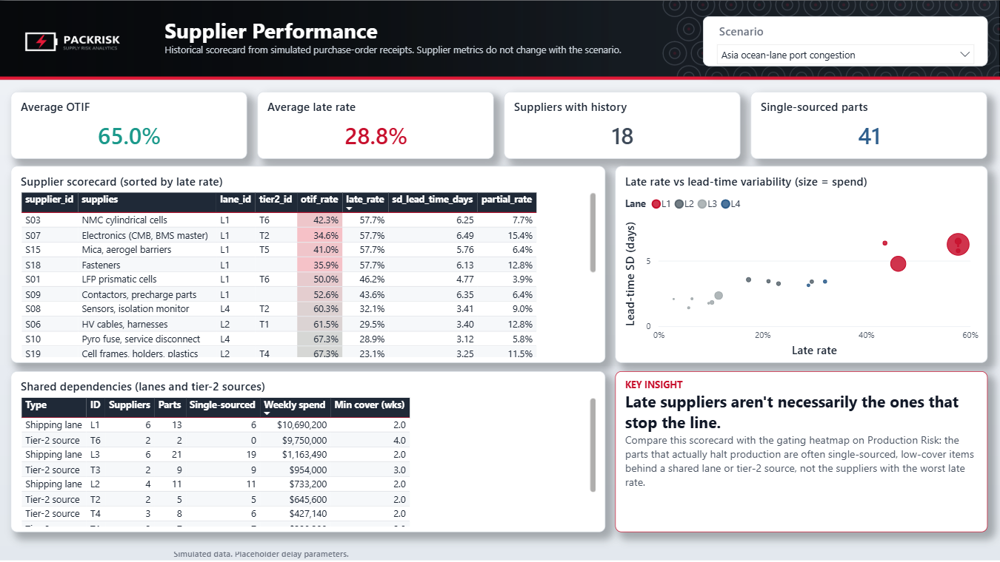
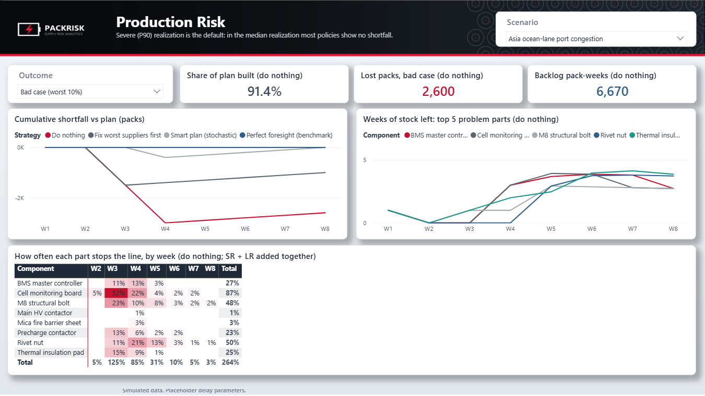
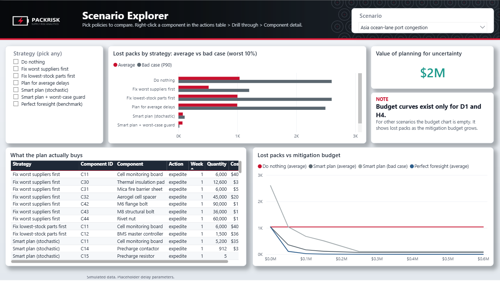
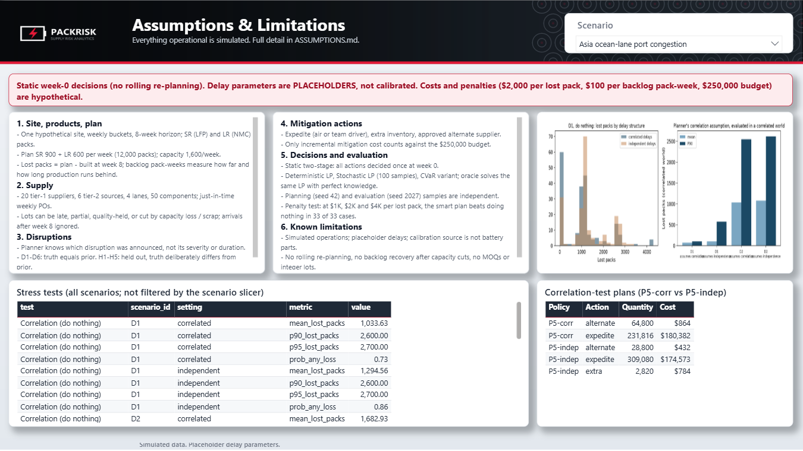

# PackRisk: Battery Pack Supply Risk & Mitigation Planner

> **Independent project. All operational data is simulated.** Delay behavior is designed to be calibrated to real public shipment data. Nothing here represents any company's suppliers, volumes, or costs.

**Question:** which components could stop the next eight weeks of battery-pack production, and how should a fixed mitigation budget be spent to protect the most packs?

PackRisk simulates a hypothetical two-variant pack assembly site (50 components, 20 suppliers, 4 shipping lanes, 6 shared tier-2 sources), samples disruptions, and compares seven mitigation policies:

| ID | Policy |
|---|---|
| P1 | Do nothing |
| P2 | Worst-supplier first (highest historical late rate) |
| P3 | Lowest-cover first |
| P4 | Deterministic LP (plans on average delays) |
| P5 | Stochastic LP (sample-average over 100 scenarios) |
| P6 | Stochastic LP + CVaR (also penalizes the worst 10%) |
| P7 | Oracle: same constraints, perfect foresight (upper bound) |

All policies are evaluated on the same realizations, including five **held-out** scenarios where the world deliberately behaves differently from the planner's assumptions.

**Results:** see [RESULTS.md](RESULTS.md) (auto-generated from the latest run). For a plain-language tour of the dashboard, read [WALKTHROUGH.md](WALKTHROUGH.md).

## Dashboard preview


| Supplier Performance | Production Risk |
|---|---|
|  |  |
| **Scenario Explorer** | **Assumptions & Limitations** |
|  |  |

Full dashboard as a PDF (no Power BI needed): [docs/PackRisk_Dashboard.pdf](docs/PackRisk_Dashboard.pdf). Scenario shown: D1, Asia ocean-lane port congestion.

## Quickstart

```bash
pip install -r requirements.txt
make all          # tests, full evaluation (~4 min), penalty sensitivity (~10 min), figures, RESULTS.md
```

Without `make` (e.g. Windows):

```bash
set PYTHONPATH=src          # PowerShell: $env:PYTHONPATH="src"
python tests/run_tests.py
python -m packrisk.evaluate
python -m packrisk.sensitivity
python -m packrisk.report
```

## Calibrate delays with real data

1. Download the USAID **Supply Chain Shipment Pricing Data** CSV into `data/raw/`. Optionally also download the DataCo **Smart Supply Chain** dataset from Kaggle.
2. Run `make calibrate USAID=data/raw/<file>.csv [DATACO=data/raw/<file>.csv]`. Check that the column names in `calibrate.py` match your file; override them with flags if not.
3. Run `make all` again. RESULTS.md, figures and Power BI tables all regenerate.

## Repository

| Path | Contents |
|---|---|
| `src/packrisk/master.py` | BOM, suppliers, lanes, tier-2 sources (hypothetical) |
| `src/packrisk/world.py` | Scenario catalog; Monte Carlo sampling of lateness, partials, holds, capacity cuts, correlated shocks |
| `src/packrisk/history.py` | 26 weeks of simulated receipts |
| `sql/` | Supplier scorecard, component exposure, shared dependencies (portable to DuckDB / dbt) |
| `src/packrisk/optimize.py` | Planning LPs (deterministic, stochastic, CVaR, oracle) and the execution model |
| `src/packrisk/policies.py` | Heuristic baselines |
| `src/packrisk/evaluate.py` | Runs everything and writes `outputs/` |
| `src/packrisk/sensitivity.py` | Re-plans every policy with a $1k / $2k / $4k lost-pack penalty |
| `src/packrisk/report.py` | Figures + RESULTS.md |
| `src/packrisk/calibrate.py` | Fits lane delay parameters from public shipment data |
| `tests/` | Invariants: inventory ≥ 0, capacity, budget, approved alternates only, oracle bound, no leakage, reproducibility |
| `outputs/powerbi/` | Star-schema CSVs for the Power BI report |
| `ASSUMPTIONS.md` | Every modeling assumption |
| `POWERBI_GUIDE.md` | Data model, DAX measures, page layouts |
| `DEMO_SCRIPT.md` | 2-minute video beat outline |
| `WALKTHROUGH.md` | Written walkthrough of the dashboard, page by page |
| `docs/` | Dashboard PDF and page images |
| `powerbi/` | Power BI Project (`PackRisk.pbip`): semantic model (TMDL), report (PBIR), theme, and the scripts that generate them |

## Power BI dashboard

Open `powerbi/PackRisk.pbip` in Power BI Desktop. The report reads the CSVs in `outputs/powerbi/`; by default it looks in `C:\packrisk\outputs\powerbi\`. If you cloned the repo somewhere else, set the folder in **Transform data > Edit parameters > DataFolder**, then click **Refresh**.

Pages: Supplier Performance, Executive Overview, Production Risk, Scenario Explorer, Assumptions & Limitations, plus a drill-through Component detail page. Power BI only filters the precomputed results; it doesn't run the optimizer.

## Disclaimer

Independent portfolio project. Not affiliated with, endorsed by, or based on data from Tesla, Inc. or any other company. All operational data is simulated, and delay parameters are placeholders until calibration is run. Public sources (company disclosures, USGS, USAID shipment data) are used for context or calibration only.

## Status

| Item | Status |
|---|---|
| Master data, generator, history, SQL analytics | Done |
| Simulator with correlated lane and tier-2 shocks | Done |
| Deterministic LP, stochastic LP, CVaR, oracle | Done (pure LP; no integer lot sizes) |
| Evaluation vs 7 policies, held-out scenarios, budget sweep, correlation tests, failure analysis | Done |
| Penalty sensitivity ($1k / $2k / $4k per lost pack) | Done |
| Tests and CI | Done |
| Delay calibration on real data | Script done; **data not yet downloaded**, so current delays are placeholders |
| Weekly rolling re-planning | Not done; decisions are made once at week 0 |
| dbt + DuckDB | SQL is portable; dbt project not yet created (SQLite runs it today) |
| Power BI report | Done (`powerbi/PackRisk.pbip`) |
| Written walkthrough | Done (`WALKTHROUGH.md`) |
