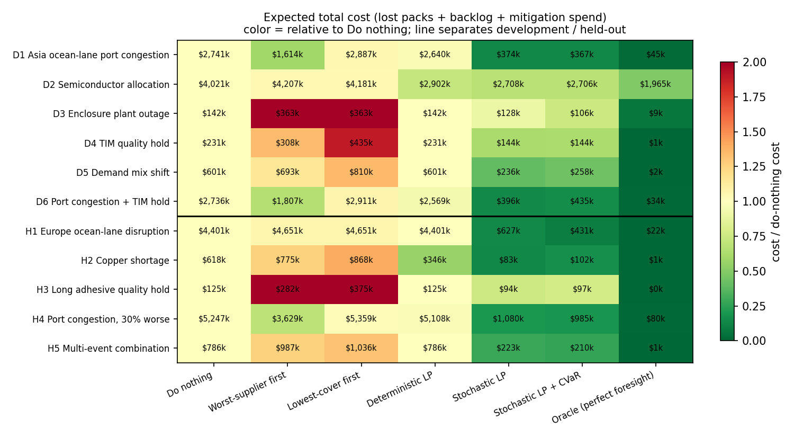
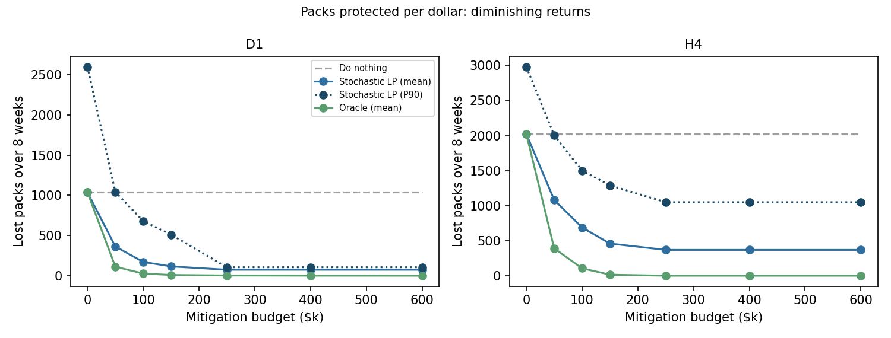
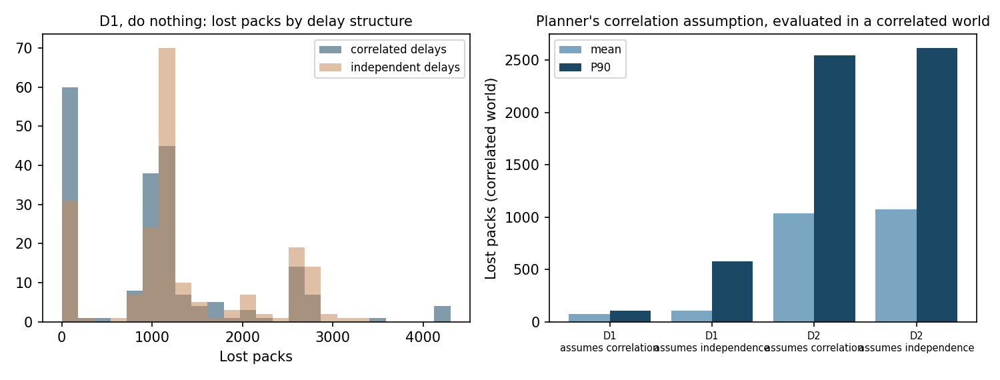
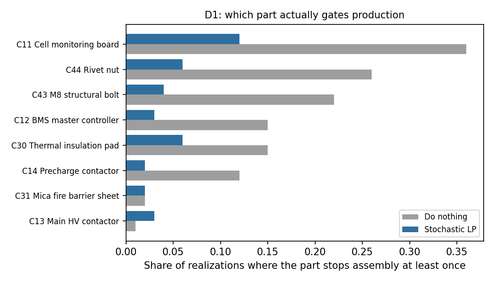
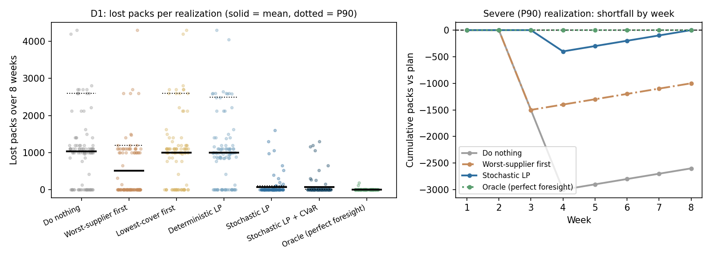

# PackRisk results

_All operational data is simulated. Results are "in simulation", never business savings._

- Delay parameters: PLACEHOLDER values. Replace by running: python -m packrisk.calibrate --usaid data/raw/<file>.csv
- 100 planning samples per scenario; 100 evaluation realizations per scenario
- Mitigation budget: $250,000 per 8-week horizon; runtime 119.0s

## Mean lost packs (8-week horizon, plan = 12,000 packs)

| Scenario | Do nothing | Worst-supplier first | Lowest-cover first | Deterministic LP | Stochastic LP | Stochastic LP + CVaR | Oracle (perfect foresight) |
|---|---|---|---|---|---|---|---|
| D1 Asia ocean-lane port congestion (development) | 1,037 | 513 | 1,001 | 997 | 75 | 68 | 3 |
| D2 Semiconductor allocation (development) | 1,738 | 1,717 | 1,711 | 1,128 | 1,035 | 1,032 | 819 |
| D3 Enclosure plant outage (development) | 60 | 49 | 49 | 60 | 46 | 35 | 4 |
| D4 TIM quality hold (development) | 97 | 25 | 77 | 97 | 58 | 59 | 0 |
| D5 Demand mix shift (development) | 257 | 195 | 241 | 257 | 84 | 60 | 0 |
| D6 Port congestion + TIM hold (development) | 1,032 | 583 | 1,004 | 968 | 93 | 89 | 0 |
| H1 Europe ocean-lane disruption (held-out) | 1,674 | 1,674 | 1,674 | 1,674 | 218 | 126 | 0 |
| H2 Copper shortage (held-out) | 258 | 222 | 258 | 134 | 19 | 26 | 0 |
| H3 Long adhesive quality hold (held-out) | 52 | 12 | 52 | 52 | 37 | 36 | 0 |
| H4 Port congestion, 30% worse (held-out) | 2,024 | 1,300 | 1,975 | 1,968 | 368 | 323 | 0 |
| H5 Multi-event combination (held-out) | 295 | 275 | 295 | 295 | 83 | 74 | 0 |

## Mean total cost ($k) = $2,000 × lost packs + $100 × backlog pack-weeks + mitigation spend

| Scenario | Do nothing | Worst-supplier first | Lowest-cover first | Deterministic LP | Stochastic LP | Stochastic LP + CVaR | Oracle (perfect foresight) |
|---|---|---|---|---|---|---|---|
| D1 Asia ocean-lane port congestion (development) | 2,741 | 1,614 | 2,887 | 2,640 | 374 | 367 | 45 |
| D2 Semiconductor allocation (development) | 4,021 | 4,207 | 4,181 | 2,902 | 2,708 | 2,706 | 1,965 |
| D3 Enclosure plant outage (development) | 142 | 363 | 363 | 142 | 128 | 106 | 9 |
| D4 TIM quality hold (development) | 231 | 308 | 435 | 231 | 144 | 144 | 1 |
| D5 Demand mix shift (development) | 601 | 693 | 810 | 601 | 236 | 258 | 2 |
| D6 Port congestion + TIM hold (development) | 2,736 | 1,807 | 2,911 | 2,569 | 396 | 435 | 34 |
| H1 Europe ocean-lane disruption (held-out) | 4,401 | 4,651 | 4,651 | 4,401 | 627 | 431 | 22 |
| H2 Copper shortage (held-out) | 618 | 775 | 868 | 346 | 83 | 102 | 1 |
| H3 Long adhesive quality hold (held-out) | 125 | 282 | 375 | 125 | 94 | 97 | 0 |
| H4 Port congestion, 30% worse (held-out) | 5,247 | 3,629 | 5,359 | 5,108 | 1,080 | 985 | 80 |
| H5 Multi-event combination (held-out) | 786 | 987 | 1,036 | 786 | 223 | 210 | 1 |

## Value of the stochastic solution and oracle capture

VSS = expected total cost of the deterministic LP minus the stochastic LP. Oracle capture = share of the do-nothing → oracle gap in lost packs that the policy closes.

| Scenario | Split | VSS ($k) | Stochastic LP oracle capture | CVaR oracle capture | Stochastic LP spend ($k) |
|---|---|---|---|---|---|
| D1 | development | 2,266 | 93% | 94% | 181 |
| D2 | development | 194 | 76% | 77% | 250 |
| D3 | development | 14 | 25% | 43% | 18 |
| D4 | development | 87 | 40% | 39% | 3 |
| D5 | development | 365 | 67% | 77% | 34 |
| D6 | development | 2,173 | 91% | 91% | 174 |
| H1 | held-out | 3,774 | 87% | 92% | 39 |
| H2 | held-out | 263 | 93% | 90% | 35 |
| H3 | held-out | 31 | 29% | 31% | 6 |
| H4 | held-out | 4,028 | 82% | 84% | 187 |
| H5 | held-out | 563 | 72% | 75% | 22 |

## Where the method fails or barely helps (auto-detected)

- **D2**: large remaining gap to the oracle (1,035 vs 819 lost packs); the budget was binding and some loss cannot be bought back.
- **D3 Enclosure plant outage**: best simple policy (Do nothing) costs $142k vs $128k for the stochastic LP (+10% advantage to the LP).
- **D4**: a heuristic protects more packs (25 lost vs 58) but spends $250k to do it; the LP judges the extra packs not worth that cost at the stated penalties.
- **H1**: large remaining gap to the oracle (218 vs 0 lost packs); the LP spent only $39k of $250k because its model judged more protection not worth the cost; the planner's prior underestimated this disruption (deliberate misspecification).
- **H3**: a heuristic protects more packs (12 lost vs 37) but spends $250k to do it; the LP judges the extra packs not worth that cost at the stated penalties.
- **H4**: large remaining gap to the oracle (368 vs 0 lost packs); the LP spent only $187k of $250k because its model judged more protection not worth the cost; the planner's prior underestimated this disruption (deliberate misspecification).

## Budget sweep (stochastic LP)

| scenario_id | budget | mitigation_cost | stochastic_mean_lost | stochastic_p90_lost | oracle_mean_lost | packs_protected |
|---|---|---|---|---|---|---|
| D1 | 0 | 0 | 1,037 | 2,600 | 1,037 | 0 |
| D1 | 50000 | 50,000 | 363 | 1,042 | 112 | 674 |
| D1 | 100000 | 100,000 | 171 | 680 | 27 | 866 |
| D1 | 150000 | 150,000 | 116 | 511 | 9 | 921 |
| D1 | 250000 | 181,246 | 75 | 106 | 3 | 963 |
| D1 | 400000 | 181,246 | 75 | 106 | 1 | 963 |
| D1 | 600000 | 181,246 | 75 | 106 | 0 | 963 |
| H4 | 0 | 0 | 2,024 | 2,981 | 2,024 | 0 |
| H4 | 50000 | 50,000 | 1,081 | 2,003 | 391 | 943 |
| H4 | 100000 | 100,000 | 688 | 1,500 | 106 | 1,336 |
| H4 | 150000 | 150,000 | 459 | 1,289 | 15 | 1,565 |
| H4 | 250000 | 187,021 | 368 | 1,049 | 0 | 1,655 |
| H4 | 400000 | 187,021 | 368 | 1,049 | 0 | 1,655 |
| H4 | 600000 | 187,021 | 368 | 1,049 | 0 | 1,655 |

## Correlation stress tests

| test | scenario_id | setting | metric | value |
|---|---|---|---|---|
| Correlation (do nothing) | D1 | correlated | mean_lost_packs | 1,033.63 |
| Correlation (do nothing) | D1 | correlated | p90_lost_packs | 2,600.00 |
| Correlation (do nothing) | D1 | correlated | p95_lost_packs | 2,700.00 |
| Correlation (do nothing) | D1 | correlated | prob_any_loss | 0.72 |
| Correlation (do nothing) | D1 | independent | mean_lost_packs | 1,294.56 |
| Correlation (do nothing) | D1 | independent | p90_lost_packs | 2,600.00 |
| Correlation (do nothing) | D1 | independent | p95_lost_packs | 2,700.00 |
| Correlation (do nothing) | D1 | independent | prob_any_loss | 0.86 |
| Planner correlation assumption | D1 | planner assumes correlation | mean_lost_packs | 74.52 |
| Planner correlation assumption | D1 | planner assumes correlation | p90_lost_packs | 105.62 |
| Planner correlation assumption | D1 | planner assumes correlation | mitigation_cost | 181,246.44 |
| Planner correlation assumption | D1 | planner assumes independence | mean_lost_packs | 103.14 |
| Planner correlation assumption | D1 | planner assumes independence | p90_lost_packs | 578.08 |
| Planner correlation assumption | D1 | planner assumes independence | mitigation_cost | 175,789.02 |
| Correlation (do nothing) | D2 | correlated | mean_lost_packs | 1,682.93 |
| Correlation (do nothing) | D2 | correlated | p90_lost_packs | 3,445.17 |
| Correlation (do nothing) | D2 | correlated | p95_lost_packs | 3,792.69 |
| Correlation (do nothing) | D2 | correlated | prob_any_loss | 0.91 |
| Correlation (do nothing) | D2 | independent | mean_lost_packs | 1,986.76 |
| Correlation (do nothing) | D2 | independent | p90_lost_packs | 3,636.28 |
| Correlation (do nothing) | D2 | independent | p95_lost_packs | 3,873.53 |
| Correlation (do nothing) | D2 | independent | prob_any_loss | 0.98 |
| Planner correlation assumption | D2 | planner assumes correlation | mean_lost_packs | 1,035.48 |
| Planner correlation assumption | D2 | planner assumes correlation | p90_lost_packs | 2,548.77 |
| Planner correlation assumption | D2 | planner assumes correlation | mitigation_cost | 250,000.00 |
| Planner correlation assumption | D2 | planner assumes independence | mean_lost_packs | 1,076.61 |
| Planner correlation assumption | D2 | planner assumes independence | p90_lost_packs | 2,616.56 |
| Planner correlation assumption | D2 | planner assumes independence | mitigation_cost | 250,000.00 |

- D1: with no mitigation, mean loss is lower when delays are correlated (1,034 vs 1,295). A planner that assumes independence, evaluated in the correlated world, has P90 loss 578 vs 106 for the planner that models correlation.
- D2: with no mitigation, mean loss is lower when delays are correlated (1,683 vs 1,987). A planner that assumes independence, evaluated in the correlated world, has P90 loss 2,617 vs 2,549 for the planner that models correlation.

## Gating parts and centerpiece

## Limitations

- All operations are simulated; delay distributions are placeholders until `calibrate.py` is run on real shipment data, and even then the source data is not battery parts.
- Decisions are made once at week 0 (static two-stage). Weekly rolling re-planning is a v2 item.
- Execution schedules production optimally against realized supply, which flatters every policy equally.
- Capacity lost to cuts and scrap is not recovered within the horizon; backlog recovery is not modeled.
- Costs, penalty per pack, BOM quantities and cover levels are hypothetical.
