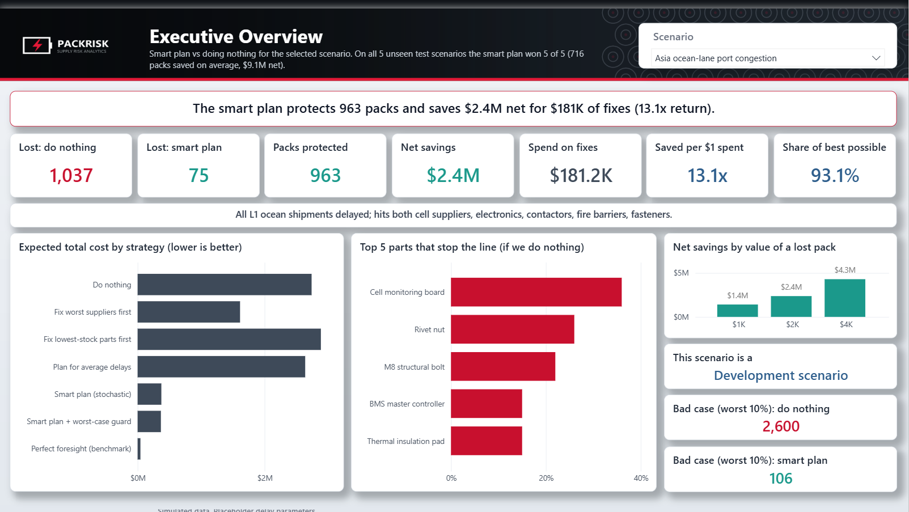

# PackRisk: a written walkthrough of the dashboard

A text version of the demo, for readers who'd rather read than watch. It follows the dashboard's page order. All numbers are for scenario **D1 (Asia ocean-lane port congestion)** unless stated otherwise.

The full dashboard is also available as a [PDF](docs/PackRisk_Dashboard.pdf).

## In three lines

- When Asia's ocean shipping congests, doing nothing loses about **1,037** of 12,000 planned battery packs over 8 weeks.
- A plan that optimizes across 100 possible futures (stochastic LP) spends **$181K** of a $250K budget, cuts losses to **75 packs**, and lowers expected total cost by **$2.4M net**.
- It also beats doing nothing on all **5 held-out scenarios** it was never tuned on, and in all **33** combinations of 11 scenarios × 3 values for a lost pack ($1K, $2K, $4K).

All operational data is simulated, and the shipping-delay parameters are placeholders until they're calibrated against public shipment records.

## The question

A battery-pack line needs 50 parts from 20 suppliers, shipped over 4 lanes. When a disruption is announced, the planner has $250,000 to spend *today* on three kinds of fixes: **expedite** a shipment (air freight or a team driver), **order extra inventory**, or **switch some volume to an approved alternate supplier**. Which parts could stop production, and where should the money go?

I compared seven strategies, from doing nothing and two rules of thumb up to three optimization models, plus a perfect-foresight "oracle" as an upper bound. Each strategy was run on 100 simulated futures for each of 11 scenarios.

The dashboard uses plain names for the strategies:

| Dashboard name | Model |
|---|---|
| Do nothing | P1, baseline |
| Fix worst suppliers first | P2, rule of thumb |
| Fix lowest-stock parts first | P3, rule of thumb |
| Plan for average delays | P4, deterministic LP |
| **Smart plan (stochastic)** | **P5, stochastic LP over 100 sampled futures** |
| Smart plan + worst-case guard | P6, stochastic LP + CVaR |
| Perfect foresight (benchmark) | P7, oracle |

## 1. Supplier Performance: late rate alone is a poor guide

- On average, **65%** of deliveries arrive on time and in full, and **28.8%** arrive late.
- The worst suppliers are the Asia ocean-lane suppliers of NMC cells, electronics boards, fire-barrier mica and fasteners. Each is late about **58%** of the time.
- **Stock cover decides which late supplier hurts you.** From those same 58%-late suppliers, the parts with 4 weeks of starting stock (NMC cells, aerogel spacer, M6 bolt) never stop the line in any scenario. The parts with 2 weeks of stock (cell monitoring board, BMS controller, rivet nut, M8 bolt) are the ones that do.
- **Low-late suppliers can still stop the line.** In three held-out scenarios (Europe lane, copper shortage, multi-event), the part that stops production most often comes from a supplier that is late only 17–29% of the time.
- **41 of the 50 parts have only one supplier,** so there is no fallback when one of them is hit.
- Shared dependencies hide the real exposure. The Asia ocean lane (L1) carries **13 parts from 6 suppliers, about $10.7M of weekly spend**, so a single port problem hits all of them at once. The cathode-material source is even bigger by spend ($9.75M a week), but none of its parts are single-sourced, so it's better protected.

**The point:** a "worst suppliers" list doesn't tell you which part will stop the line. Stock cover, single-sourcing and the disruption itself do.

On the dashboard, supplier history is fixed, but every visual on this page shows its impact in the selected scenario: the KPI cards (parts and suppliers that stop the line, their average late rate, the worst part), a "stops line here" column in the scorecard and the dependency table, scatter bubbles sized by how often each supplier's parts stop the line, and the red table of parts. In Asia port congestion, 4 suppliers averaging 54% late cause the stoppages; in copper shortage, the top supplier (S05) is late only 17% of the time.

## 2. Executive Overview: the answer

| | Do nothing | Stochastic LP plan |
|---|---|---|
| Packs lost (average) | 1,037 | 75 |
| Mitigation spend | $0 | $181K (72.5% of budget) |
| Expected total cost | $2.74M | $0.37M |

- **963 packs protected** and **$2.4M net cost avoided**, about **13x** the money spent. Total cost already includes the mitigation spend, so the saving is net.
- The plan gets **93%** of the improvement a perfect-foresight plan could achieve.
- The plan didn't need the whole budget: extra spending wasn't worth its cost.
- **Held-out test:** five scenarios behave differently from what the planner assumed (for example, a copper shortage and port congestion 30% worse than expected). The plan beat doing nothing in **5 of 5**, protecting **716 packs per scenario** on average and avoiding **$9.1M** in total.

Expected total cost = mitigation spend + $2,000 per lost pack + $100 per pack-week of backlog. Both penalties are assumptions.

**Does the answer depend on the $2,000 assumption?** No. I re-planned every strategy with a lost pack worth $1,000 and $4,000 and scored them on the same simulated futures:

| Value of a lost pack | D1 net savings, smart plan vs doing nothing |
|---|---|
| $1,000 | $1.4M |
| $2,000 | $2.4M |
| $4,000 | $4.3M |

Across all 11 scenarios and 3 penalty values, the smart plan beats doing nothing **33 of 33** times. The cheapest strategy is always one of the two smart plans; a rule of thumb or the average-delay plan is never the cheapest.

## 3. Production Risk: where and when it breaks

- With no action, the line builds **91.4%** of plan on average. In a bad case (the worst 10% of runs) it loses **2,600 packs**.
- In a bad case, cumulative output falls about **3,000 packs behind plan by week 4** and only partly recovers.
- The battery cells hold 4 weeks of stock, so they ride out the delay. The **cell monitoring board** has 2 weeks of stock, one supplier and an ocean-lane route. It is the part that stops the line most often: in about **36%** of runs, with **week 3** the peak.
- Cheap parts show up too: rivet nuts and M8 structural bolts are among the top five bottlenecks.
- In that bad case, stock for these parts reaches zero in weeks 2 to 4, exactly when the shortfall starts.

## 4. Scenario Explorer: what each plan actually buys

| Strategy | Packs lost | Spend | Expected total cost |
|---|---|---|---|
| Do nothing | 1,037 | $0 | $2.74M |
| Worst-supplier first | 513 | $250K | $1.61M |
| Lowest-cover first | 1,001 | $250K | $2.89M |
| Deterministic LP (plans on average delays) | 997 | about $250 | $2.64M |
| **Stochastic LP** | **75** | **$181K** | **$0.37M** |
| Stochastic LP + CVaR | 68 | about $201K | $0.37M |
| Oracle (perfect foresight) | 3 | $36K | $0.04M |

- **Lowest-cover first costs more than doing nothing.** It spends the full budget on parts that weren't the problem.
- **Planning on average delays buys almost nothing,** because the average delay looks survivable. Planning for the range of outcomes is worth about **$2.3M** here (the "value of the stochastic solution").
- The stochastic plan spends mostly on **expediting the electronics boards and fasteners**, the same parts flagged as bottlenecks.
- The CVaR version gives up very little on average cost and protects the worst cases much better.
- **Diminishing returns:** losses fall from 1,037 to 363 with the first $50K and to 171 at $100K, then flatten. Most of the value comes from the first $100K.

## 5. Assumptions and limitations

- **Simulated operations** and **placeholder delays.** The calibration script fits lane delays from the public USAID Supply Chain Shipment Pricing dataset, but it hasn't been run yet. That data is health-commodity freight, not battery parts, so it would give realistic delay *shape*, not battery-specific truth.
- **Static decisions:** everything is decided once at week 0. There is no weekly re-planning yet.
- **Hypothetical costs:** the $2,000 lost-pack penalty and $100 backlog penalty drive the trade-off. The penalty test shows the ranking holds at $1K and $4K per lost pack, but the size of the savings scales with the penalty.
- **Shared risk matters, but not everywhere:** in Asia port congestion, a planner that wrongly assumes suppliers' delays are independent sees its bad-case loss rise from **106 to 578 packs**. Across all 11 scenarios, modelling the shared shock lowers the bad-case loss in 6, makes no difference in 4 (no loss either way), and is slightly worse in 2 (D6 and H5, by 14–28 packs).
- **Small disruptions:** for a single-supplier plant outage (D3) only about 60 packs are at risk, and no plan adds much. The net return there is 0.8x.

## What I'd build next

1. Run the delay calibration on real shipment data.
2. Add weekly re-planning, so the plan can react as the disruption unfolds.
3. Test the backlog penalty the same way as the lost-pack penalty.
